## Задание 1

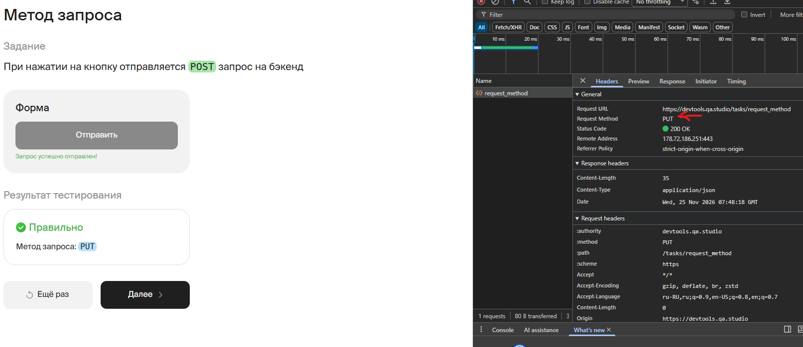

## Задание 2

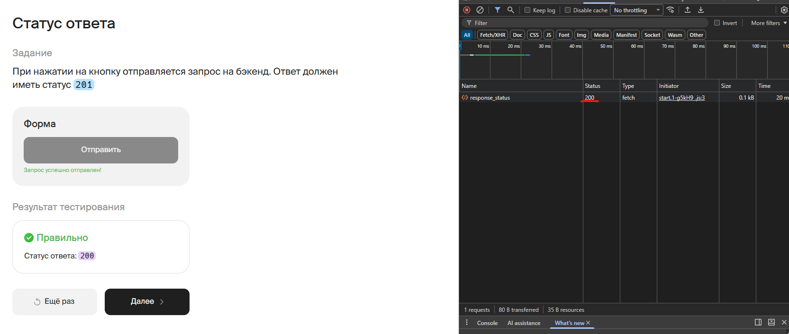

## Задание 3

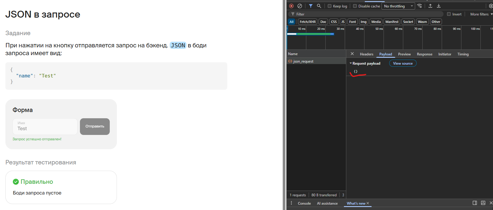

## Задание 4

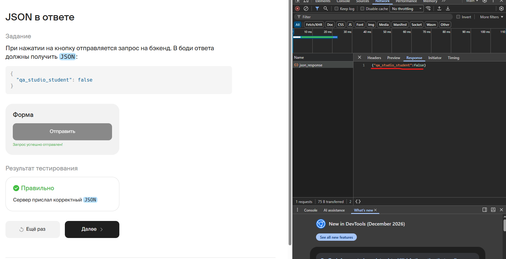

## Задание 5

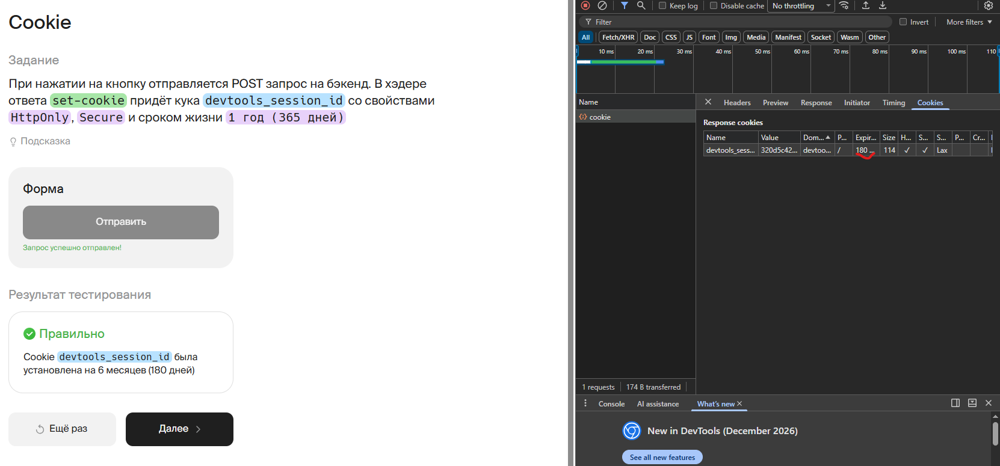

## Задание 6

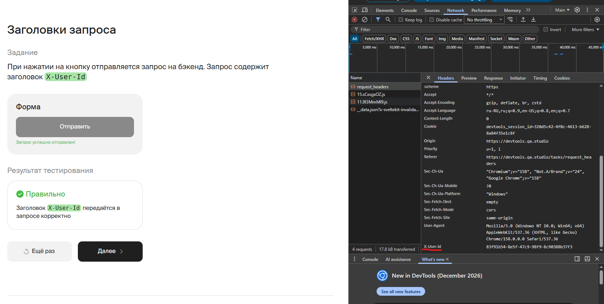

## Задание 7

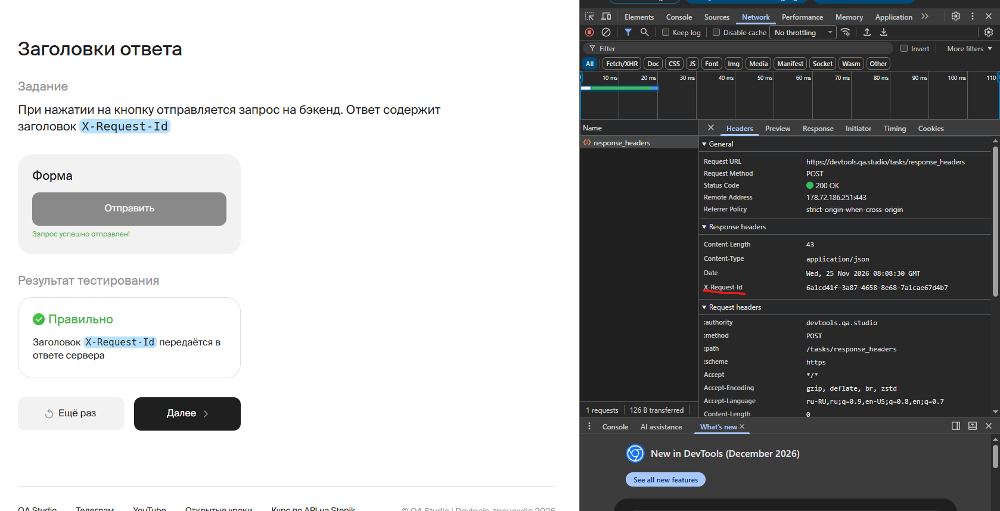

## Задание 8

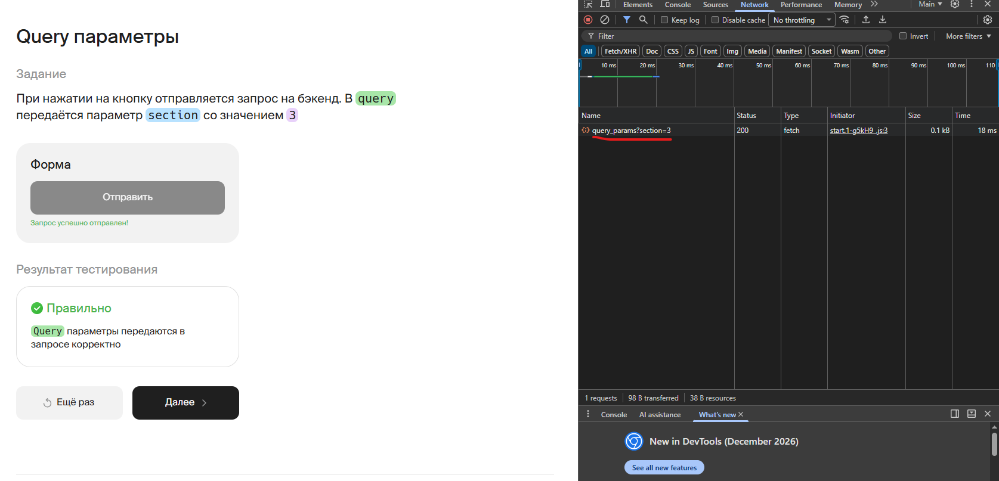

## Задание 9

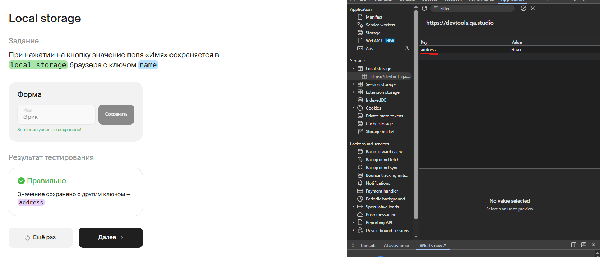

## Задание 10

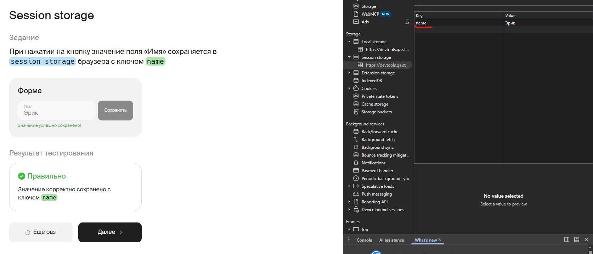

## Задание 11

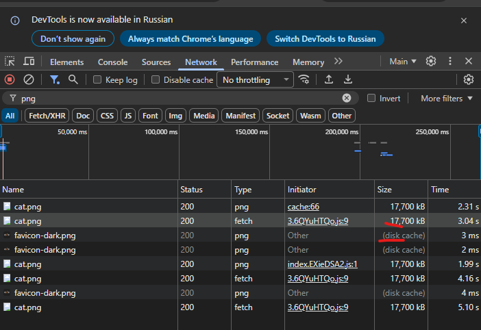

## Задание 12

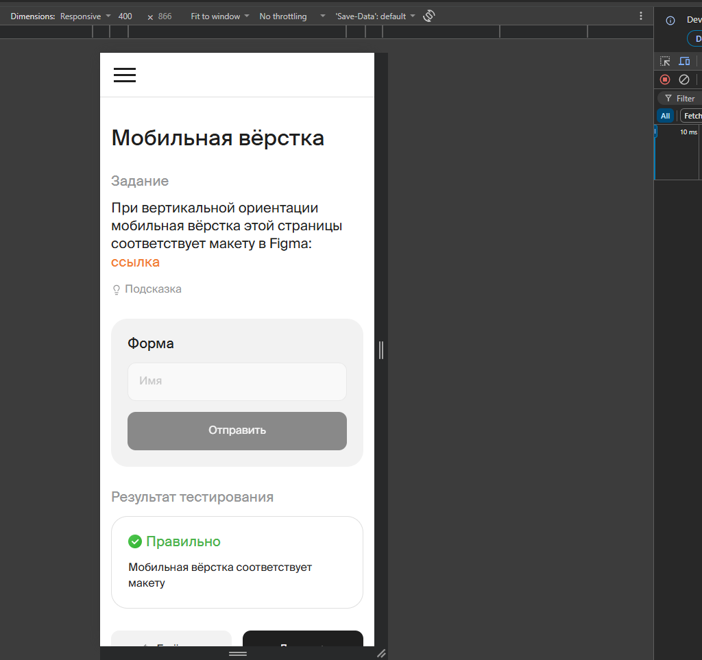

## Задание 13

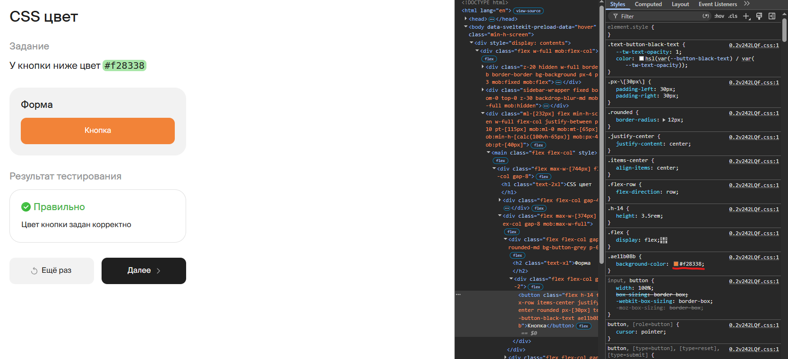

## Задание 14

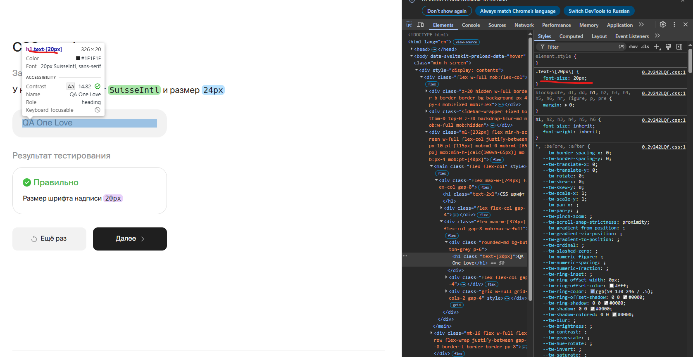

## Задание 15

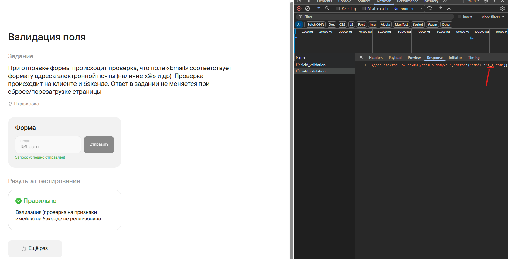

Я отправил форму, потом скопировал запрос как fetch

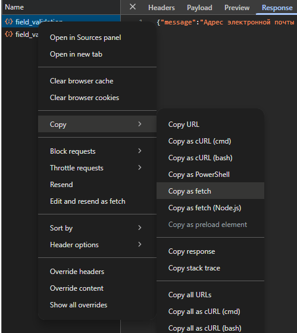

Потом вставил его в коносль и отредактировал email на неправильный и отправил

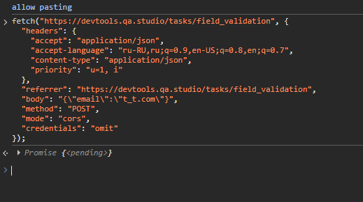
